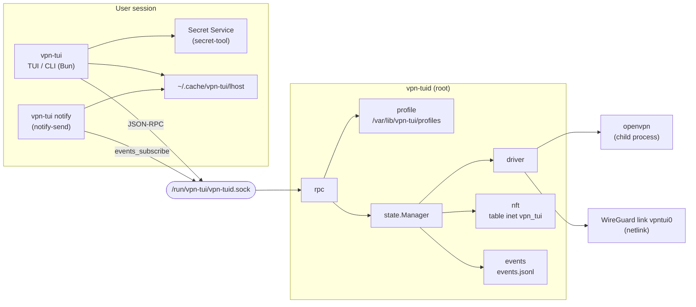
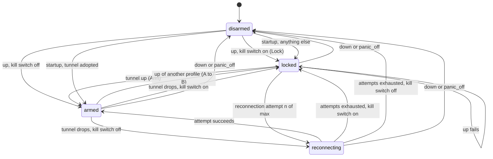
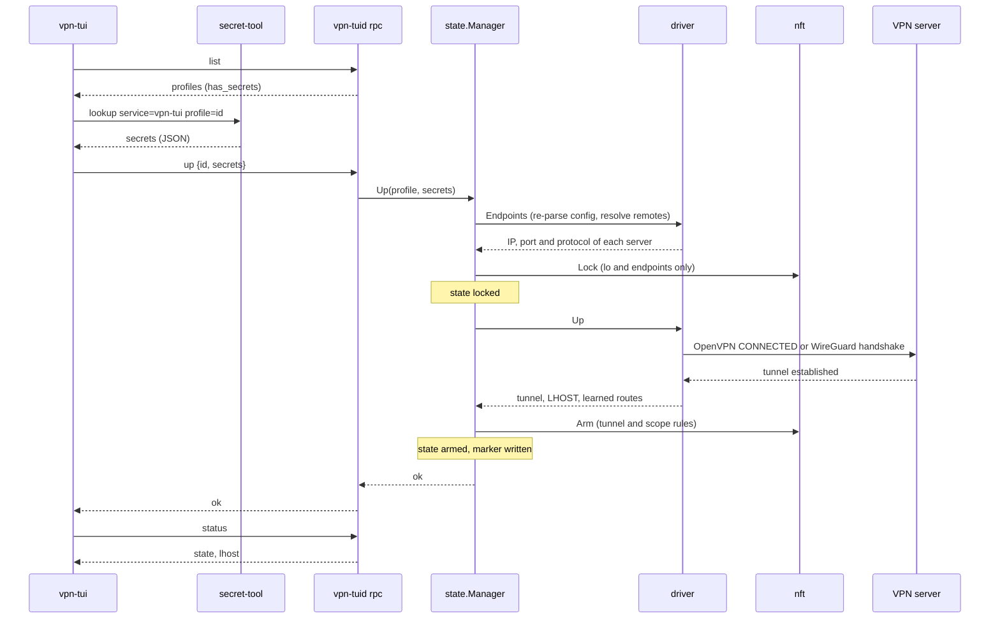

# Architecture

This page describes the components of vpn-tui, the state machine of the daemon, what an `up` does, the nftables rules of each state, startup reconciliation, the journal and coexistence with other firewall rules.

## Components

`vpn-tuid` is a Go daemon that runs as root. `vpn-tui` is a Bun program (TUI and CLI) that runs in the user session. They talk over a Unix socket with JSON-RPC 2.0, one JSON message per line, 64 KiB at most per message. The contract is [`proto/rpc.schema.json`](../proto/rpc.schema.json). The daemon validates every request against it. The client validates its requests, the responses and the event notifications.



| Go package (`daemon/internal/`) | Role |
| --- | --- |
| `rpc` | Socket server. Checks the caller (`SO_PEERCRED`, group), validates each request against the schema, dispatches the methods. |
| `profile` | Profile store under `/var/lib/vpn-tui/profiles`, every file access through `os.Root`. |
| `ovpn` | Allowlist parser for `.ovpn` files, OpenVPN launch and control (management socket), adoption of a surviving process. |
| `wg` | Allowlist parser for WireGuard files, interface and routing setup through netlink and `wgctrl`. |
| `driver` | Adapts `ovpn` and `wg` to the `state.Driver` interface. The interface is always named `vpntui0`. |
| `state` | `Manager`: state machine, reconnection, panic-off, startup reconciliation. |
| `nft` | Builds the ruleset (pure function) and applies it atomically through netlink. Only touches the table `inet vpn_tui`. |
| `events` | Event bus, `events.jsonl` journal, purge. |
| `health` | Reconnection backoff. |
| `kernel` | Host probes for reconciliation (table present, interface present, PID alive). An error is read as "present" so that the daemon locks. |
| `dns` | Applies the profile DNS to the tunnel interface with `resolvectl`. |
| `netinfo` | Read-only netlink helpers (tunnel IPv4, routes). |

The daemon calls neither `nft` nor `iptables`. It talks to the kernel through netlink libraries. The only external programs it starts are `openvpn` and `resolvectl`.

Only one profile is active at a time. The daemon exits after `--idle-timeout` with no connection, but never while a VPN is active or a lock is in place. Exiting (restart, rebuild) never removes the firewall: the table, the tunnel and the markers stay in place and the next start picks them up (see [Startup reconciliation](#startup-reconciliation)). OpenVPN runs in its own process group and the NixOS unit uses `KillMode=process`, so a daemon stop does not take the tunnel down with it. Only the `down` and `panic_off` methods and `vpn-tuid --panic-off` disarm.

## State machine

The daemon is in one of four states, reported by `status` as `disarmed`, `armed`, `reconnecting` or `locked`.

| State | Meaning |
| --- | --- |
| `disarmed` | No profile active, no firewall. |
| `armed` | Tunnel up. With the kill switch on, the armed ruleset is in place. |
| `reconnecting` | The tunnel is down and the daemon is retrying. With the kill switch on, the lock stays in place during the attempts. |
| `locked` | Lock ruleset in place: only `lo` and the VPN endpoints may leave. |



Transitions, with their source in `daemon/internal/state/`:

- **Up with kill switch** (`Manager.Up`): `Lock` with the profile endpoints, then the tunnel is started, then `Arm`. If the tunnel fails, the state stays `locked` (the firewall is not removed) until `down`. A `down` or `panic_off` received while the tunnel is still connecting aborts the connection at once.
- **Up from `locked`**: the lock blocks DNS, so the remote names of a profile cannot be resolved. Retrying the same profile reuses the endpoints resolved before the lock (or those of the marker). Bringing up another profile whose remote is a hostname needs `down` first. An `up` that fails before touching the firewall never records `disarmed` while the table is in place.
- **Up without kill switch**: no firewall. On success the state is `armed`, on failure `disarmed`.
- **Switching from A to B without disarming**: when A is armed with the kill switch on, `Up(B)` first applies `Lock` with the endpoints of A and B together, then stops the tunnel of A, then locks for B, starts B and arms. The table is replaced atomically at each step and never removed, so the host is never open between the two profiles. If A has no kill switch, there is no firewall to keep. If B has none, the lock applied for A is released once B is up.
- **Drop**: a watcher detects a dead tunnel (interface gone, OpenVPN exited or reconnecting, WireGuard without handshake while packets are sent). With the kill switch on, the daemon applies `Lock` and moves to `locked`; otherwise it moves to `reconnecting`. It emits `drop`.
- **Reconnection**: up to `--reconnect-max-attempts` attempts (default 10). Attempt `a` waits `1 s × 2^(a-1)`, capped at `--reconnect-max-backoff` (default 60 s). The secrets come from daemon memory. During an attempt the state is `reconnecting`; the firewall is not touched. A failed attempt emits `error` with the cause. A successful attempt re-arms and emits `up`. An `up` of another profile during an attempt waits (20 s at most) for the attempt to release the interface before starting.
- **Exhausted attempts**: with the kill switch on, the state stays `locked` until `down` or `panic_off` (event `lock`). Without it, the state becomes `disarmed`.
- **No secrets** (the daemon restarted while armed, so the secrets are gone): a drop leads to `locked` with the kill switch on, `disarmed` without it. No reconnection is attempted.
- **`down`**: stops the tunnel, removes the table, removes the marker. If one step fails, the daemon applies `Lock` and the state becomes `locked`.
- **`panic_off`**: cancels any reconnection, stops the tunnel (3 s limit), removes the table, removes the marker, drops the secrets. The state is `disarmed`.
- **Up of the profile already `armed`**: refused (error `-32004`, busy).

## What `up` does



Details that the diagram does not show:

- The client skips the keyring step when the profile has no secrets, and the daemon rejects an `up` without secrets for a profile that needs them.
- `Endpoints` re-reads the stored configuration and parses it again with the allowlist on every `up` and every reconnection. Remote names are resolved to IPs before the lock, so the lock only needs the IPs.
- OpenVPN waits for the `CONNECTED` state, at most `--connect-timeout` (60 s). WireGuard sets the keepalive to force a handshake and waits at most 10 s (fixed). A timeout tears the interface down.
- After the tunnel is up, the daemon reads the interface routes (default routes excluded) as the learned scope and emits `scope_learned` if there are any. It does not add them to the profile.
- The client writes the LHOST to `~/.cache/vpn-tui/lhost` after the `status` call.
- With the kill switch off, the `Lock` and `Arm` steps do not exist.

## nft rules by state

The daemon only manages the table `inet vpn_tui`. It has two base chains, `output` and `forward`, both with `type filter`, priority `filter - 10` (that is -10) and `policy accept`. Each transition is one netlink batch that deletes and recreates the table, so the replacement is atomic. The rules below come from the golden files in `daemon/internal/nft/testdata/`.

| State | Table | `output` chain | `forward` chain |
| --- | --- | --- | --- |
| `disarmed` | absent | none | none |
| `locked`, or `reconnecting` with the kill switch on | present | `lo` accept, endpoints accept, `drop` | `drop` |
| `armed`, kill switch on | present | see below | see below |
| `reconnecting`, kill switch off | absent | none | none |

Lock ruleset (`locked.nft`, one IPv4 and one IPv6 endpoint):

```text
table inet vpn_tui {
	chain output {
		type filter hook output priority filter - 10; policy accept;
		oifname "lo" accept
		ip daddr 203.0.113.7 udp dport 51820 accept
		ip6 daddr 2001:db8::7 tcp dport 443 accept
		drop
	}
	chain forward {
		type filter hook forward priority filter - 10; policy accept;
		drop
	}
}
```

Armed ruleset. Rules are evaluated in this order; conditional rules appear only when their condition holds.

| # | Rule | Chain | Condition |
| --- | --- | --- | --- |
| 1 | `oifname "lo" accept` | output | always |
| 2 | `oifname "<iface>" accept` | output, forward | always (the interface is `vpntui0`) |
| 3 | `ip daddr <ip> <proto> dport <port> accept` (`ip6` for IPv6) | output | one per endpoint |
| 4 | `ip daddr { scope.cidrs } ip daddr != { scope.exclude } drop` | output, forward | IPv4 scope not empty (the `!=` part only with `exclude`) |
| 5 | same with `ip6 daddr` | output, forward | IPv6 scope not empty |
| 6 | `meta nfproto ipv6 drop` | output, forward | `block_ipv6` |
| 7 | `udp dport { 53, 853 } drop` and `tcp dport { 53, 853 } drop` | output | `dns.force` |
| 8 | `drop` | output, forward | `allow_internet = false` |

Example with `allow_internet = true`, `block_ipv6 = true`, `dns.force = true` (`armed_allowtrue_v6true_dnstrue.nft`):

```text
table inet vpn_tui {
	chain output {
		type filter hook output priority filter - 10; policy accept;
		oifname "lo" accept
		oifname "tun0" accept
		ip daddr 203.0.113.7 udp dport 51820 accept
		ip daddr { 10.10.0.0/16 } drop
		meta nfproto ipv6 drop
		udp dport { 53, 853 } drop
		tcp dport { 53, 853 } drop
	}
	chain forward {
		type filter hook forward priority filter - 10; policy accept;
		oifname "tun0" accept
		ip daddr { 10.10.0.0/16 } drop
		meta nfproto ipv6 drop
	}
}
```

Notes:

- The tests use `tun0` as the interface name. The daemon always uses `vpntui0`.
- CIDR lists are sorted, deduplicated, and a prefix covered by another one is dropped.
- `Build` refuses an armed ruleset without a valid interface name, and any invalid CIDR or endpoint, before touching the kernel.
- The final `drop` (row 8) also covers IPv6 when `allow_internet = false`.

## Startup reconciliation

Before accepting any connection, the daemon compares the persisted state (`/run/vpn-tui/state.json`) with the host (`Reconcile`). "Active" means the persisted state is `armed`, `reconnecting` or `locked`, or `state.json` exists but is unreadable. The decision table:

| Persisted state | nft table | `vpntui0` | Other conditions | Action | Outcome |
| --- | --- | --- | --- | --- | --- |
| not active | absent | absent | | none | `clean` |
| not active | present | any | | `Lock` (endpoints from the marker; none if there is no marker) | `locked` |
| not active | absent | present | | delete the interface | `orphan_cleaned` |
| `armed` | any | present | OpenVPN PID alive (or WireGuard), profile exists, adoption succeeds, endpoints known (marker, else resolved), `Arm` succeeds | re-attach to the tunnel, `Arm` | `resumed` |
| active, any other case | any | any | | `Lock` | `locked` |
| any | | | firewall or interface deletion error | try `Lock`, return the error | `locked` |

Rules that apply to the whole table:

- `Reconcile` never calls `Disarm`.
- A `resumed` session has no secrets: if the tunnel drops later, there is no reconnection (see [state machine](#state-machine)).
- The `kernel` probes fail closed: an error counts as "table present", "interface present", "PID alive".
- `state.json` lives in `/run` (tmpfs) and disappears at reboot. The marker `/var/lib/vpn-tui/armed.json` survives. `vpn-tuid --restore-lock`, run at boot, reads the marker and applies the lock, so that the host is locked before the daemon starts. The daemon then finds a `locked` state and keeps the lock.
- The result is logged and written to the journal as a `reconcile` event (`clean`, `locked`, `orphan_cleaned`, `resumed`).

## Journal

Every event goes through a bus that does two things: it appends one JSON line to `/var/cache/vpn-tui/events.jsonl` (mode 0640), and it pushes the event to each subscriber (`events_subscribe`, used by the TUI and `vpn-tui notify`). A subscriber has a buffer of 64 events; a slow subscriber loses events instead of blocking the daemon.

An event has the fields `time` (UTC), `profile` (id or `null`), `state`, `kind` and `detail` (1024 bytes at most). The kinds emitted by the daemon are `up`, `down`, `drop`, `reconnect`, `lock`, `panic_off`, `reconcile`, `scope_learned` and `error`. The schema also lists `peer_rejected`, which the daemon does not emit.

The daemon purges entries older than `--journal-max-age` (7 days) at startup and then every hour. The `logs` method returns the last 1000 entries since a date. Details of the retention are in [configuration.md](configuration.md#journal-and-retention). Secrets never go through the bus.

## Coexistence with other nftables chains

Several base chains can be registered on the same hook, in the same table or in different tables, and netfilter runs all of them in priority order. The consequences for `vpn_tui`:

- `accept` in one base chain only ends that chain. The packet still goes through the base chains that come after. The accept rules of `vpn_tui` (`lo`, tunnel, endpoints) therefore never override a `drop` from another chain.
- `drop` is final, wherever it comes from. A drop in `vpn_tui` cannot be undone by another table, and a drop in another table cannot be undone by `vpn_tui`.
- The chains of `vpn_tui` sit at priority -10, so they run before the chains at priority 0 (the `filter` priority used by most firewalls).

`vpn_tui` is a separate table. The daemon does not read, reorder or delete other tables, and it does not run `nft` or `iptables`. It works whether `networking.firewall` uses the iptables-nft backend or the nftables backend, and it does not depend on `networking.nftables.enable`. This has not been tested against the NixOS firewall in this repository: the netns tests (`daemon/internal/nft/netns_test.go`) only check `vpn_tui` itself.

One limit: a `flush ruleset` run by another tool also deletes `vpn_tui`. The daemon checks the table at startup only, not while it runs.
